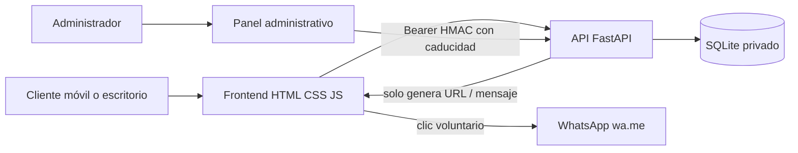

# Arquitectura de referencia · APEX_PRIME_X v0.1.0

## Principios

- **Coste mínimo:** aplicación y datos locales sin dependencia de APIs pagadas.
- **Límite de confianza:** precios, stock, disponibilidad y estados son autoridad del servidor, jamás del carrito del navegador.
- **Privacidad:** los datos de clientes se conservan exclusivamente en la base local; el endpoint público de seguimiento entrega la información imprescindible.
- **Evolución:** separar interfaz, controladores HTTP, reglas de negocio y persistencia gradualmente; migración futura a PostgreSQL y panel multiusuario.
- **Operación responsable:** ninguna conexión a sistemas reales ni publicación sin aprobación.

## Flujo lógico

## Rutas

| Método | Ruta | Control de acceso | Función |
|---|---|---|---|
| GET | `/api/health` | Público | Salud |
| GET | `/api/config` | Público | Configuración pública (sin secretos) |
| GET | `/api/products` | Público | Catálogo activo; categoría/tipo opcionales |
| POST | `/api/quotes` | Público, validado y limitado | Registrar cotización y preparar WhatsApp |
| POST | `/api/quote-status` | Código + teléfono, limitado | Consultar estado sin datos personales |
| POST | `/api/admin/login` | Contraseña, limitado | Emitir token temporal |
| GET | `/api/admin/me` | Administrador | Identidad básica |
| GET | `/api/admin/summary` | Administrador | KPIs |
| GET/POST | `/api/admin/products` | Administrador | Lista completa / alta |
| PUT | `/api/admin/products/{id}` | Administrador | Editar / ocultar sin borrar histórico |
| GET | `/api/admin/quotes` | Administrador | Recepción de solicitudes |
| PATCH | `/api/admin/quotes/{id}/status` | Administrador | Seguimiento comercial |
| GET/POST | `/api/admin/jobs` | Administrador | Órdenes de servicio |
| PATCH | `/api/admin/jobs/{id}` | Administrador | Progreso de ejecución |

## Modelo de datos

- `products`: SKU único, tipo, categoría, nombre, precio opcional en céntimos PEN, inventario opcional, visibilidad.
- `quotes`: referencia pública aleatoria, información mínima del contacto, snapshot JSON de líneas/PU; total opcional; estado comercial y marcas temporales.
- `service_jobs`: referencia interna, cliente, notas, estado operativo, cotización relacionada opcional.

Se evitan los errores de precisión decimal en cálculos al almacenar y sumar enteros en céntimos. Una cotización con artículo sin precio conocido mantiene `total_cents=NULL`.

## Seguridad actual

- Pydantic valida payloads y rechaza campos imprevistos en solicitudes y artículos.
- SQLite usa parámetros enlazados (evita concatenar datos del usuario en consultas).
- Contraseña administrativa PBKDF2-SHA256 con sal, 500.000 iteraciones; no contraseña predeterminada.
- Sesión con HMAC-SHA256 y expiración de 8 horas, mantenida exclusivamente en memoria del navegador.
- Cabeceras CSP, `X-Frame-Options`, `nosniff`, `Referrer-Policy`; respuestas sensibles `no-store`.
- Límites por IP **en memoria** para login, cotizaciones y consultas de estado; insuficientes para redes distribuidas.
- URL `wa.me` generada por backend sin envíos automáticos.

## Próximo diseño recomendado

1. Integrar Postgres y Alembic; tabla `users`/`roles`, sesiones revocables y auditoría; separación por organización si comercializa el SaaS.
2. Jobs asíncronos para comunicaciones consentidas, colas de eventos y notificación al cliente; ninguna notificación sin consentimiento.
3. Métricas de embudo e histórico por responsable/servicio, más conversión comercial.
4. Integraciones bancarias y recibos solo con proveedor autorizado, contrato, controles antifraude y sandbox homologado.
